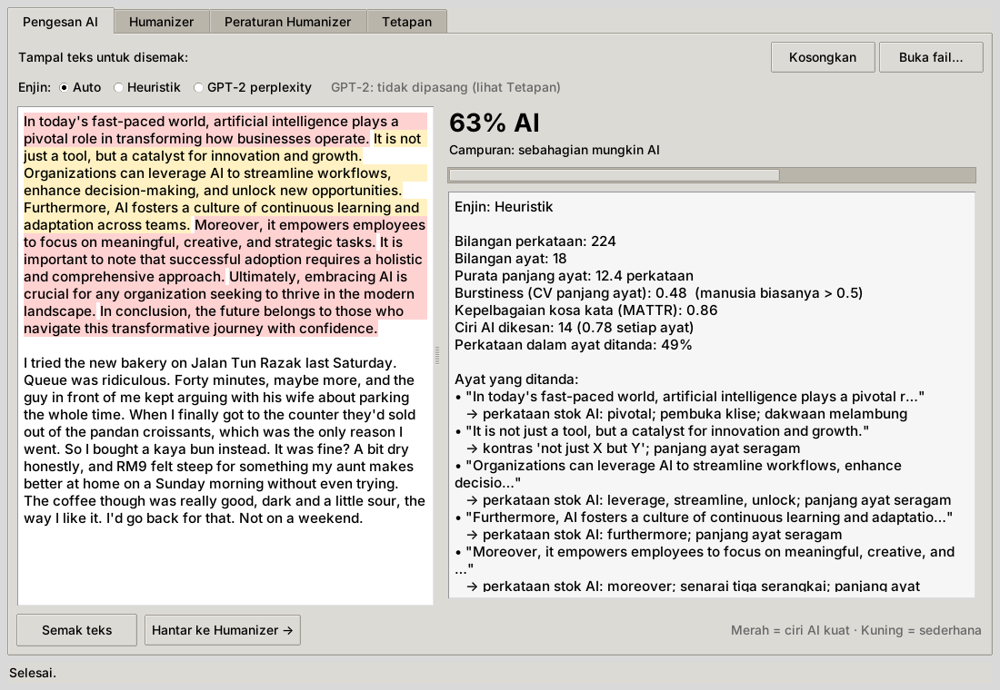

# TeksAI

App desktop Linux untuk **mengesan teks yang mungkin dijana AI** dan **menulis semula teks supaya lebih semula jadi** (humanizer).



## Pasang

Muat turun [`dist/teksai_1.0.0_all.deb`](dist/teksai_1.0.0_all.deb), kemudian:

```bash
sudo apt install ./teksai_1.0.0_all.deb
```

Perlukan Ubuntu/Debian dengan Python 3.10 atau lebih baru. Semasa pemasangan, internet diperlukan untuk memuat turun pakej Python `anthropic` ke `/opt/teksai/venv`.

Buka **TeksAI** dari menu aplikasi, atau jalankan `teksai` di terminal.

Buang: `sudo apt remove teksai`

## Ciri

| Tab | Fungsi |
|---|---|
| Pengesan AI | Skor peratus AI dan tanda ayat yang mencurigakan (merah/kuning). Berjalan secara lokal. |
| Humanizer | Tulis semula teks menggunakan Claude API dengan kunci API anda sendiri. |
| Peraturan Humanizer | Paparkan peraturan suntingan yang dihantar kepada model. |
| Tetapan | Kunci API Anthropic, dan pemasang enjin GPT-2. |

### Enjin pengesan

- **Heuristik** (lalai): hanya pustaka standard Python. Mengukur burstiness (variasi panjang ayat), perkataan stok AI dan pola struktur. Anggaran kasar, paling sesuai untuk teks Inggeris.
- **GPT-2 perplexity** (pilihan): pasang dengan `sudo teksai --install-gpt2` (~1.5 GB: PyTorch CPU + transformers + model GPT-2).

Tiada pengesan AI yang tepat 100%. Jangan gunakan skor ini sebagai bukti.

### Humanizer

Menggunakan peraturan dari [blader/humanizer](https://github.com/blader/humanizer) (lesen MIT), disertakan dalam `packaging/teksai/opt/teksai/humanizer/`. Model: Claude Opus 5.5 (lalai), Sonnet 5.5 atau Haiku 5.5. Kos API ditanggung oleh akaun Anthropic anda.

Kunci API disimpan dalam `~/.config/teksai/config.json` (mod 600), atau guna pembolehubah `ANTHROPIC_API_KEY`.

## CLI

```bash
teksai detect fail.txt
teksai detect --engine heuristic fail.txt
teksai humanize fail.txt
```

## Bina semula .deb

```bash
./build.sh
```

Hasil di `dist/`. Kod sumber berada di `packaging/teksai/opt/teksai/teksai/`.

## Struktur

```
packaging/teksai/
  DEBIAN/            control, postinst (cipta venv), postrm
  opt/teksai/teksai/ kod Python (app.py, detector.py, humanizer.py, ...)
  opt/teksai/humanizer/  SKILL.md, README, LICENSE dari blader/humanizer
  usr/bin/teksai     pelancar
  usr/share/...      fail .desktop dan ikon
dist/                pakej .deb siap
```
